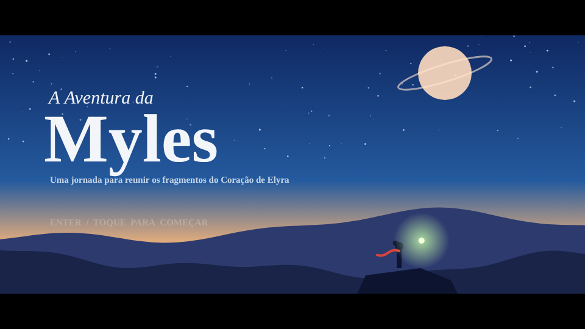
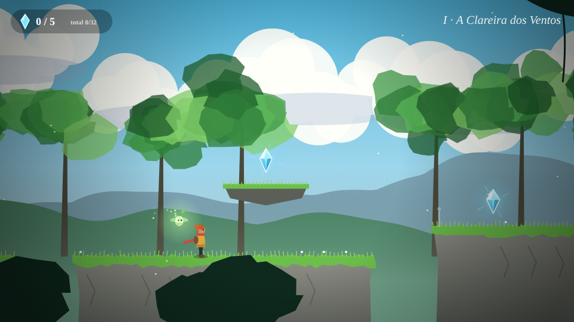
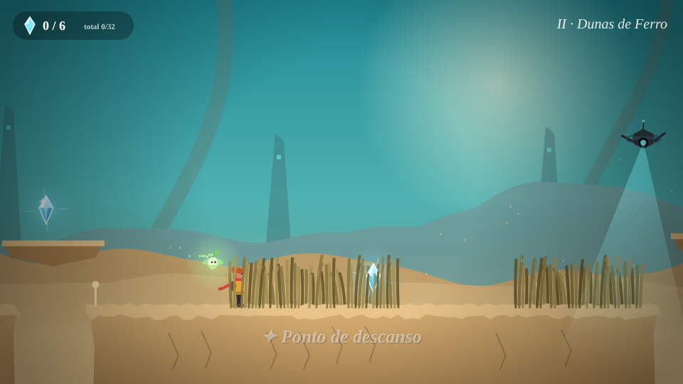
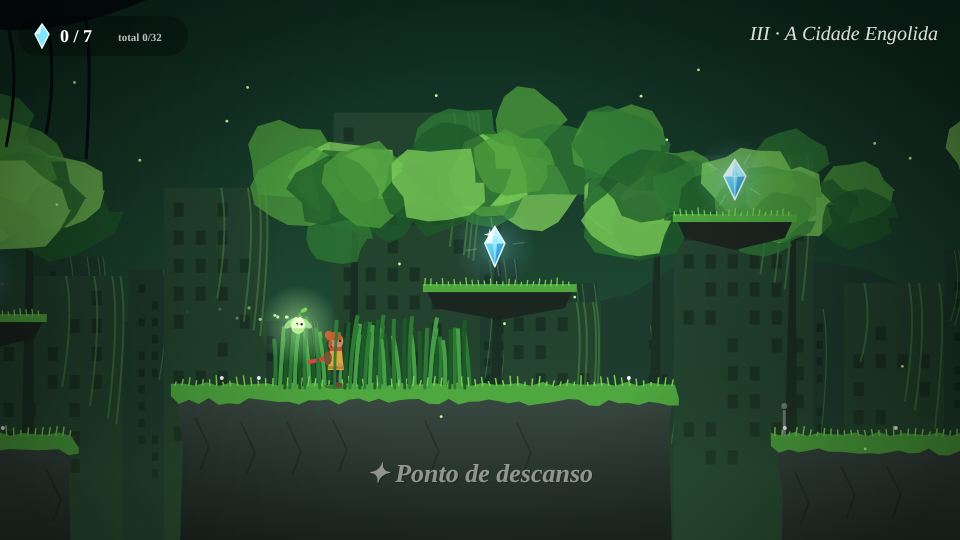
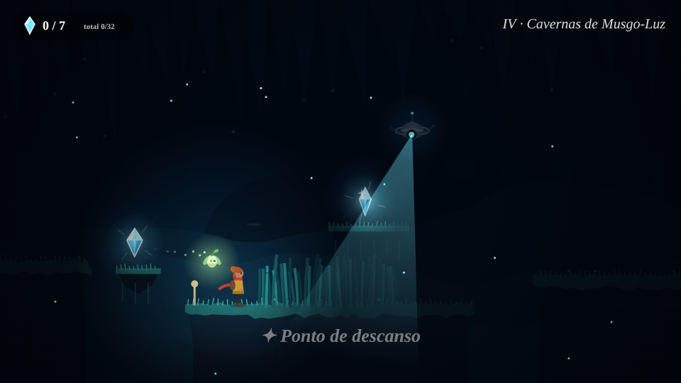
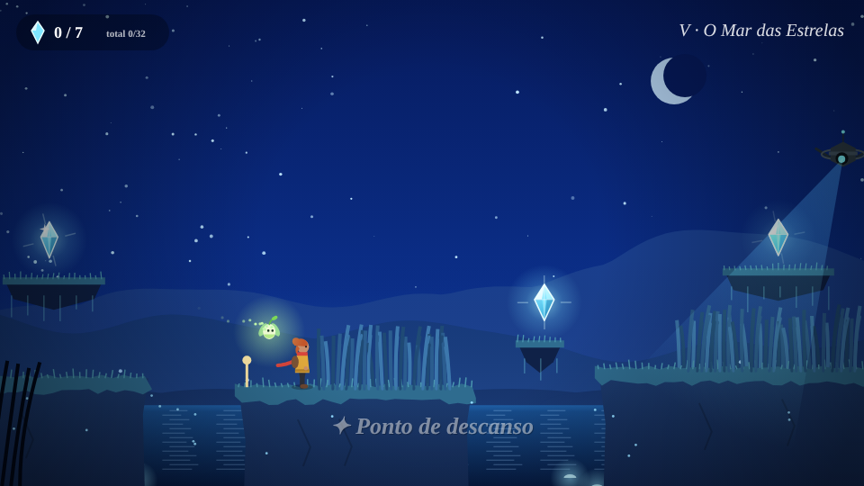

# 🌿 A Aventura da Myles

> Um jogo de plataforma e quebra‑cabeça cinematográfico, feito inteiramente em **HTML5 Canvas + JavaScript puro**, num único arquivo, sem imagens, sem bibliotecas e sem engine.



**▶️ Jogar:** abra o `index.html` no navegador ou ([veja aqui](https://skylinenando.github.io/GAME-A-Aventura-da-Myles)).

---

## 📖 Sumário

1. [Sobre o jogo](#-sobre-o-jogo)
2. [Como jogar](#-como-jogar)
3. [As fases](#-as-fases)
4. [Como o código foi criado](#-como-o-código-foi-criado)
5. [Arquitetura geral](#-arquitetura-geral)
6. [Explicação de cada função](#-explicação-de-cada-função)
7. [Como criar uma nova fase](#-como-criar-uma-nova-fase)
8. [Bugs que foram corrigidos](#-bugs-que-foram-corrigidos)
9. [Como pode melhorar (roadmap)](#-como-pode-melhorar-roadmap)
10. [Publicando no GitHub](#-publicando-no-github)
11. [Créditos e licença](#-créditos-e-licença)

---

## 🌍 Sobre o jogo

**Elyra** era um planeta onde a floresta e as máquinas antigas dormiam lado a lado, guardadas pelo **Coração de Cristal**. Numa noite sem lua, os **Silentes**, sentinelas de metal, despertaram e quebraram o Coração em mil fragmentos.

**Myles**, uma garota ruiva de cachecol vermelho da vila de Brisa‑Alta, parte com **Pip**, um espírito‑semente luminoso, para reunir os fragmentos e devolver o equilíbrio ao planeta.

O jogo é inspirado no gênero de *plataforma cinematográfica* (câmera lateral, cenários pintados em camadas, furtividade e um companheiro que ajuda a resolver quebra‑cabeças). **Todos os personagens, a história, as máquinas e a arte são originais** e são desenhados por código.

| | |
|---|---|
| **Gênero** | Plataforma 2D · Furtividade · Quebra‑cabeça |
| **Tecnologia** | HTML5 Canvas 2D, Web Audio API, JavaScript (ES6) |
| **Tamanho** | 1 arquivo, cerca de 850 linhas, sem dependências |
| **Plataformas** | Navegador de computador e celular (controles de toque) |
| **Fases** | 5 fases · 32 fragmentos |

---

## 🎮 Como jogar

| Ação | Teclado | Celular |
|---|---|---|
| Andar | `←` `→` ou `A` `D` | ◀ ▶ |
| Pular | `Espaço`, `↑` ou `W` | ⤒ |
| Agachar / esconder | `↓` ou `S` | ▼ |
| Mandar o Pip ativar a flor‑chave | `E` ou `Q` | PIP |
| Avançar textos | `Enter` / `Espaço` | Tocar na tela |

**Objetivo:** pegar todos os **fragmentos de cristal** da fase e chegar ao **Altar**, que só acende quando a fase está completa.

**Mecânicas:**
- 🌾 **Furtividade:** agache dentro do mato alto para ficar *escondida*. Os drones dos Silentes vasculham com um feixe de luz; se ficarem vendo a Myles por tempo demais, ela é capturada.
- 🌱 **Pip:** perto de um portão fechado, aperte `E`. O Pip voa até a *flor‑chave*, ativa o mecanismo e o portão desce.
- ✦ **Pontos de descanso:** checkpoints. Ao cair ou ser capturada, a Myles volta para o último.

---

## 🗺️ As fases

| # | Fase | Tema | Novidade |
|---|---|---|---|
| I | **A Clareira dos Ventos** | Floresta de dia | Tutorial: pulo, mato, Pip e portão |
| II | **Dunas de Ferro** | Deserto com redemoinhos | Drones patrulhando |
| III | **A Cidade Engolida** | Ruínas tomadas por raízes | Feixes que varrem, 2 portões |
| IV | **Cavernas de Musgo‑Luz** | Caverna escura | Só a luz do Pip ilumina |
| V | **O Mar das Estrelas** | Mar noturno | Saltos de ilha em ilha |

| | |
|---|---|
|  |  |
|  |  |
|  | |

---

## 🛠️ Como o código foi criado

O jogo foi construído em etapas, sempre testando no navegador entre uma etapa e outra:

1. **Base técnica:** um `<canvas>` com resolução lógica fixa de **960×540** que é escalado para caber na tela, mais um *game loop* com **passo de tempo fixo (60 atualizações/s)**.
2. **Dados antes do código:** cada fase é um **objeto de dados** (chão, plataformas, mato, drones, portões, fragmentos e checkpoints). A lógica é a mesma para todas; só os dados mudam.
3. **Física simples e previsível:** colisão **AABB** (retângulos alinhados aos eixos), gravidade, *coyote time* e *jump buffer* para deixar o controle macio.
4. **Arte 100% procedural:** nenhuma imagem é carregada. Céu, montanhas, árvores, prédios, personagens e máquinas são desenhados com formas do Canvas (`arc`, `ellipse`, `lineTo`, gradientes).
5. **Paralaxe:** cada camada do fundo anda numa velocidade diferente da câmera (fator `f`), o que cria profundidade.
6. **Aleatório determinístico:** a função `hash(n)` sempre devolve o mesmo número para o mesmo `n`. Assim árvores, janelas e rochas parecem "aleatórias", mas **não mudam de forma quando a câmera anda**.
7. **Furtividade:** cada drone projeta um **cone** de visão; a detecção é feita por distância e ângulo.
8. **Polimento:** partículas, sons sintetizados pela Web Audio API, transições com *fade*, barras de cinema, vinheta e tremor de tela.
9. **Testes automáticos:** um navegador sem interface (Playwright) roda roteiros que tentam atravessar portões fechados, testam o pulo e a captura, conferem se os 32 fragmentos estão ao alcance e tiram as capturas de tela.

---

## 🧱 Arquitetura geral

```
index.html
├── <style>         Layout de tela cheia + botões de toque
├── <div #touch>    Controles para celular
└── <script>
    ├── SETUP        canvas, escala, canvas da escuridão
    ├── INPUT        teclado, toque, funções left/right/jump/down
    ├── AUDIO        Web Audio: beep() e efeitos sfx
    ├── UTIL         hash, lerp, clamp, ridge
    ├── HISTÓRIA     textos, LEVELS (dados das fases), THEMES (paletas)
    ├── ESTADO       variáveis globais, jogador P, companheiro pip
    ├── FÍSICA       update(), updatePip(), caught(), partículas
    ├── DESENHO      draw() e todas as funções draw*
    └── LOOP         requestAnimationFrame com passo fixo
```

### Máquina de estados

```
title ──► intro ──► story ──► play ──► levelEnd ──► story (próxima fase) … ──► end ──► title
                                │ ▲
                                ▼ │
                            caughtWait   (capturada ou caiu → fade → respawn)
```

A variável `state` decide o que `update()` processa e o que `draw()` desenha. A função `onAny()` faz as transições quando o jogador aperta `Enter`, `Espaço` ou toca na tela.

### Ciclo de um quadro

```
loop(now)
 ├── enquanto houver tempo acumulado ≥ 16,6 ms:
 │     update()      ← física, IA, regras (sempre 60×/s)
 └── draw()          ← desenha uma vez por quadro de tela
```

O passo fixo garante que o pulo tenha **a mesma altura em qualquer computador**, seja ele de 60 Hz ou de 144 Hz.

---

## 📚 Explicação de cada função

### ⚙️ Setup e entrada

| Função / constante | O que faz |
|---|---|
| `W`, `H` | Resolução lógica do jogo (960×540). Toda a lógica usa essas coordenadas. |
| `resize()` | Calcula a escala para caber na janela, ajusta o tamanho real do canvas pela densidade de pixels (`devicePixelRatio`, até 2×) e mostra o aviso "gire o celular" quando ele está em pé. |
| `K` | Mapa das teclas pressionadas (`K.Space === true`). |
| `T` | Estado dos botões de toque (`L`, `R`, `D`, `J`, `E`). |
| `left()`, `right()`, `jump()`, `down()` | Juntam teclado e toque numa única pergunta: "o jogador quer ir para a esquerda?". |
| `ePressed` | Marca um pedido único para o Pip (é consumido em `updatePip`). |
| Evento `blur` | Solta todas as teclas quando a janela perde o foco, para a Myles não andar sozinha. |

### 🔊 Áudio

| Função | O que faz |
|---|---|
| `unlockAudio()` | Cria ou retoma o `AudioContext`. Os navegadores só liberam áudio depois de um gesto do usuário. |
| `beep(f, d, type, v, slide)` | Sintetiza um som: oscilador de frequência `f`, duração `d`, volume `v` e deslize de tom opcional (`slide`). |
| `sfx.frag/jump/pip/gate/alert/caught` | Efeitos prontos, montados com um ou mais `beep()`. |

### 🧮 Utilitários

| Função | O que faz |
|---|---|
| `hash(n)` | Pseudoaleatório **determinístico** entre 0 e 1. É a base de toda a arte procedural estável. |
| `lerp(a, b, t)` | Interpolação linear; usada para suavizar câmera, velocidade e o voo do Pip. |
| `clamp(v, a, b)` | Limita um valor a um intervalo. |
| `ridge(x, s, a)` | Soma de três senoides que gera o contorno de montanhas e dunas. |

### 🗺️ Dados

| Constante | O que contém |
|---|---|
| `STORY_INTRO` | Texto do prólogo. |
| `LEVELS[]` | Uma entrada por fase: `name`, `theme`, `w` (largura), `text`, `g` (chão), `p` (plataformas), `h` (mato), `d` (drones), `gt` (portões), `f` (fragmentos), `c` (checkpoints) e `dark` (opcional). |
| `THEMES{}` | Paleta de cada tema: céu, camadas de montanha, topo e corpo do chão, folhagem, neblina e tipo de partícula ambiente. |

### 🧠 Estado e fluxo

| Função | O que faz |
|---|---|
| `P` | Jogador: posição, velocidade, `on` (no chão), `face`, `crouch`, `hidden`, `alert` (0–100), `coyote`, `jbuf`, `grace` e `scarf` (pontos do cachecol). |
| `pip` | Companheiro: posição, alvo, estado (`follow`, `go`, `return`) e piscar. |
| `loadLevel(i)` | Converte os dados de `LEVELS[i]` em objetos do jogo: `solids`, `plats`, `hides`, `drones`, `gates`, `walls` (torres acima dos portões) e `frags`. |
| `respawn(first)` | Coloca a Myles no checkpoint atual, em cima do chão, e zera o alerta. Dá **90 quadros de proteção** (`P.grace`) e reposiciona o Pip. |
| `say(texto, duração)` | Mostra uma mensagem na parte de baixo da tela. |
| `goFade(callback)` | Escurece a tela e, quando ela está totalmente preta, executa o `callback` (trocar de fase, renascer…). |
| `onAny(código)` | Trata `Enter`, `Espaço` e toque nas telas de título, história, fim de fase e final. Ignora cliques durante uma transição. |

### 🏃 Física e lógica

| Função | O que faz |
|---|---|
| `overlap(a, b)` | Teste AABB: dois retângulos se sobrepõem? |
| `gateRects()` | Retângulo atual de cada porta. A altura diminui conforme `open` vai de 0 a 1 (a porta afunda no chão). |
| `gateSolids()` | Só as portas com altura maior que 1 px; evita que uma porta aberta, com altura zero, continue bloqueando. |
| `update()` | **Coração do jogo**, rodando 60 vezes por segundo:<br>1. Fade de transição.<br>2. Agachar: a altura da hitbox muda de 44 para 30 px.<br>3. Aceleração horizontal com `lerp` (mais controle no chão, menos no ar).<br>4. **Jump buffer** (8 quadros) e **coyote time** (7 quadros).<br>5. Pulo variável: soltar o botão cedo corta a subida.<br>6. Movimento e colisão **separados por eixo** (primeiro X, depois Y), com chão, torres e portas.<br>7. Plataformas *one‑way*: só colidem quando a Myles vem de cima.<br>8. Queda no abismo, checkpoints, esconderijo e coleta de fragmentos.<br>9. Drones: patrulha, varredura do feixe e teste de **cone de visão** (distância < 330 e ângulo < 0,3 rad).<br>10. Barra de alerta: chega a 100 → `caught()`.<br>11. Pip, portas, altar, câmera, tremor e física do cachecol. |
| `updatePip()` | Estados do Pip: **follow** (flutua atrás da Myles), **go** (voa até a flor‑chave e abre o portão) e **return** (volta). Também solta partículas de luz. |
| `caught(motivo)` | Toca o som, treme a tela, entra em `caughtWait` e faz *fade* → `respawn` → `play`. |
| `dust(x, y, n)` | Poeira ao pular e pousar. |
| `burst(x, y, cor, n)` | Explosão de brilho (fragmento coletado, portão aberto). |
| `ambient()` | Partículas de clima: pólen, areia, esporos, brilhos ou estrelas, conforme o tema. Também move e remove partículas (limite de 400). |

### 🎨 Desenho

| Função | O que faz |
|---|---|
| `draw()` | Organiza a ordem de pintura: fundo → mundo (com câmera) → escuridão → feixes e brilhos → primeiro plano → HUD → telas de texto → fade. |
| `drawFade()` | Retângulo preto com a opacidade de `fade`. |
| `skyGrad()` | Gradiente vertical do céu do tema. |
| `drawBackground()` | Desenha estrelas, lua, nuvens, sol, torres‑monólito e redemoinhos (deserto) e o Guardião de Pedra (caverna). Depois chama as camadas de paralaxe e a neblina. |
| `cloud(x, y, r)` | Nuvem feita de vários círculos sobrepostos. |
| `layer(f, cor, base, amp, seed)` | Silhueta de montanha com paralaxe `f`, usando `ridge()`. |
| `buildings(f, cor, sc)` | Prédios em ruínas com janelas e cipós (fase III). |
| `treeLayer(f)` | Distribui árvores em "células" de 150 px; cada célula tem um índice `i` fixo. |
| `tree(x, base, h, dim, id)` | Tronco curvo e copa com 11 *blobs*. A forma usa `id`, **e não a posição na tela**, por isso não muda quando a câmera anda. |
| `blob(cx, cy, r, seed)` | Forma orgânica irregular (folhagem, arbustos). |
| `stalactites(f, cor)` | Estalactites com pontos brilhantes (caverna). |
| `drawSeaBack()` | Mar com reflexos animados e águas‑vivas de luz. |
| `drawWorld()` | Mato de trás, chão, plataformas, altar, checkpoints, portões, fragmentos, partículas, Myles, mato da frente (que cobre a Myles), Pip e drones. |
| `solidY(x)` | Altura do chão numa coordenada X. |
| `drawGround(s)` | Bloco de rocha com gradiente, fissuras, faixa de grama com folhas que balançam e florzinhas. |
| `drawPlat(p)` | Plataforma flutuante com base pontuda. |
| `drawHide(h, front)` | Mato alto em duas passadas: atrás e na frente da personagem. Mostra "escondida". |
| `drawFrag(f)` | Fragmento: halo pulsante, raios girando, cristal com 4 faces e contorno e uma estrela que pisca. |
| `drawAltar(x, y)` | Pilar com runas; acende quando todos os fragmentos da fase foram coletados. |
| `drawGate(g, r)` | Torre de pedra, moldura, porta deslizante com luz vermelha ou verde, fio pontilhado e flor‑chave com dica de tecla. |
| `drawMyles()` | Personagem animada: sombra, cachecol com física, pernas com ciclo de corrida (`sin`), botas, túnica, mochila, braço, cabeça, cabelo com coque e olho. Vira com `P.face`. |
| `solidUnder()` | Encontra o chão abaixo da Myles para desenhar a sombra. |
| `drawPip()` | Halo, asinhas de folha batendo, corpo‑semente, broto e olhos que piscam e olham na direção da Myles. |
| `drawDrone(d)` | Silente: corpo hexagonal, anel, hastes, olho que segue o feixe e antena. Ciano quando calmo, vermelho em alerta. |
| `drawBeams(boost)` | Cones de luz com `globalCompositeOperation = 'lighter'` (luz que soma). |
| `drawParticles(glowOnly)` | Desenha partículas normais ou brilhantes, com opacidade pelo tempo de vida. |
| `drawDarkness()` | **Iluminação da caverna:** pinta um canvas extra de preto e "fura" buracos de luz com `destination-out` em volta do Pip, da Myles, dos fragmentos e dos drones. |
| `drawForeground()` | Silhuetas em primeiro plano (paralaxe 1,3), galhos pendurados, vinheta e tela avermelhada quando em alerta. |
| `drawHUD()` | Contador de fragmentos, nome da fase, olho com barra de alerta, indicador de "escondida" e mensagens. |
| `roundRect()` | Retângulo de cantos arredondados. |
| `bars()` | Barras pretas de cinema. |
| `drawText(linhas, título)` | Tela de história e prólogo. |
| `drawLevelEnd()` | Tela "O Altar desperta". |
| `drawTitle()` | Cena do título: céu ao entardecer, planeta com anel, silhueta da Myles com cachecol e o Pip brilhando. |
| `drawEnd()` | Final: o Coração restaurado com partículas em órbita. |
| `loop(now)` | `requestAnimationFrame` com acumulador: roda `update()` em passos fixos de 1/60 s e chama `draw()` uma vez. |

---

## ➕ Como criar uma nova fase

Adicione um objeto ao array `LEVELS`:

```js
{ name:"VI · Picos Gelados", theme:"forest", w:4000,
  text:["Linha 1 da história","Linha 2"],
  g:[[0,900,450],[1000,800,430]],      // chão: [x, largura, y_do_topo]
  p:[[700,340,120]],                   // plataforma: [x, y, largura]
  h:[[300,200,450]],                   // mato: [x, largura, y_do_chão]
  d:[[1000,1600,190,1.8,.5]],          // drone: [x1, x2, altura, velocidade, varredura]
  gt:[[3500,450,3420,370]],            // portão: [x, y_chão, x_flor, y_flor]
  f:[[760,300],[1500,400]],            // fragmentos: [x, y]
  c:[0,1000]                           // checkpoints (x)
}
```

**Regras de design** (baseadas na física atual):
- O pulo sobe cerca de **135 px** e alcança cerca de **160 px** na horizontal. Use buracos de até **100 px** e degraus de até **120 px**.
- Coloque o fragmento a no máximo ~170 px acima de uma superfície.
- Sempre ponha mato entre as áreas patrulhadas por drones.

Para um tema novo, crie uma entrada em `THEMES` e, se quiser, um bloco próprio em `drawBackground()`.

---

## 🐞 Bugs que foram corrigidos

| Bug | Causa | Correção |
|---|---|---|
| Portão aberto continuava bloqueando | Um retângulo de altura 0 ainda "sobrepunha" no teste AABB | `gateSolids()` ignora portas com `h ≤ 1` |
| Dava para pular por cima do portão | Porta de 230 px, mas plataformas próximas | Torre sólida (`walls`) acima de cada porta |
| Segurar Enter pulava as histórias | Repetição automática do teclado | Ignora `e.repeat` e bloqueia cliques durante o fade |
| Pulo apertado antes de pousar era perdido | O buffer dependia de a tecla ser solta | Detecta a borda de pressionar (`jp`) |
| Plataformas no limite do pulo | Pulo de 11,6 era curto demais | Velocidade de pulo 12,2 |
| Captura imediata ao renascer | Drone em cima do checkpoint | `P.grace` = 90 quadros de proteção |
| Árvores mudavam de forma ao andar | `hash()` usava a posição **na tela** | `hash()` usa o índice **fixo** da árvore |
| Fragmentos "pela metade" | Só uma face clara e achatamento até zero | Novo cristal com 4 faces, contorno e escala mínima de 0,7 |
| Sem som em alguns navegadores | `AudioContext` criado fora de um gesto do usuário | `unlockAudio()` em teclas e toques |

---

## 🚀 Como pode melhorar (roadmap)

### Código e arquitetura
- [ ] **Separar em módulos ES** (`input.js`, `physics.js`, `render/`, `levels/`) e usar um *bundler* leve (Vite).
- [ ] **Classes ou entidades** (`Player`, `Drone`, `Gate`) no lugar de objetos soltos e variáveis globais.
- [ ] **Fases em JSON** separados e um **editor de fases** visual no navegador.
- [ ] **TypeScript** para pegar erros de digitação nos dados das fases.
- [ ] **Testes automatizados** (Playwright + Vitest) no GitHub Actions a cada *push*.
- [ ] Constantes de física nomeadas (`GRAVITY`, `JUMP_VELOCITY`…) em vez de números soltos.

### Desempenho
- [ ] **Cache das camadas de fundo** em canvas fora da tela; hoje as árvores são redesenhadas a cada quadro.
- [ ] **Particionar o mundo** (grade espacial) para testar colisão só com objetos próximos.
- [ ] *Object pool* de partículas para evitar criar lixo para o coletor de memória.
- [ ] Pausar o jogo quando a aba fica oculta (`visibilitychange`).

### Jogabilidade
- [ ] **Salvar progresso** (`localStorage`): fase atual e fragmentos coletados.
- [ ] **Menu de pausa** e opções (volume, controles, idioma PT/EN).
- [ ] Novas habilidades do Pip: **iluminar** áreas, **distrair** drones, **puxar** alavancas a distância.
- [ ] Plataformas móveis, caixas para empurrar, água para nadar e cordas para balançar.
- [ ] **Chefe final:** o núcleo dos Silentes, com padrões de ataque em fases.
- [ ] Drones que **seguem o último ponto visto** antes de voltar à patrulha.
- [ ] **Bloqueio de visão:** hoje o feixe atravessa plataformas; dá para fazer *raycast* contra os sólidos.
- [ ] Cenas animadas (*cutscenes*) entre fases.
- [ ] Suporte a **controle (Gamepad API)**.

### Arte e som
- [ ] Trilha sonora ambiente procedural (acordes lentos com Web Audio) e sons de passos por tipo de chão.
- [ ] Iluminação dinâmica também nas fases noturnas; sombras projetadas pelos feixes.
- [ ] Animações extras: escalar bordas, aterrissagem pesada, idle com respiração.
- [ ] Ciclo de dia e noite e chuva na fase da floresta.

### Acessibilidade
- [ ] Modo daltônico (feixes com padrão, além da cor).
- [ ] Opção de dificuldade (velocidade dos drones e tempo de detecção).
- [ ] Remapeamento de teclas e legendas maiores.

---

## 🌐 Publicando no GitHub

Na conta **SkylineNando**:

```bash
# 1. Crie o repositório "aventura-da-myles" em github.com/new
# 2. Na pasta com estes arquivos:
git init
git add .
git commit -m "A Aventura da Myles - versão 1.0"
git branch -M main
git remote add origin https://github.com/SkylineNando/aventura-da-myles.git
git push -u origin main
```

**Para jogar online (GitHub Pages):** no repositório, abra *Settings → Pages → Source: Deploy from a branch → Branch: `main` / `(root)` → Save*. Em cerca de 1 minuto o jogo fica em:

```
https://skylinenando.github.io/aventura-da-myles/
```

### Estrutura do repositório

```
aventura-da-myles/
├── index.html        ← o jogo completo
├── README.md         ← esta documentação
├── LICENSE
└── screenshots/
    ├── 00-titulo.png
    ├── 01-clareira.png
    ├── 02-dunas.png
    ├── 03-cidade.png
    ├── 04-cavernas.png
    └── 05-mar.png
```

---

## 📝 Créditos e licença

- **Criação e direção:** [SkylineNando](https://github.com/SkylineNando)
- **Fontes:** Cormorant Garamond e Nunito (Google Fonts, licença SIL Open Font License)

Código distribuído sob a licença **MIT**; veja [`LICENSE`](LICENSE).
